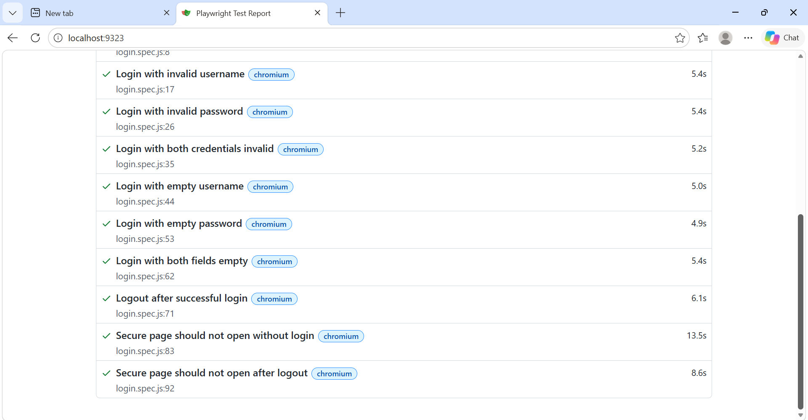
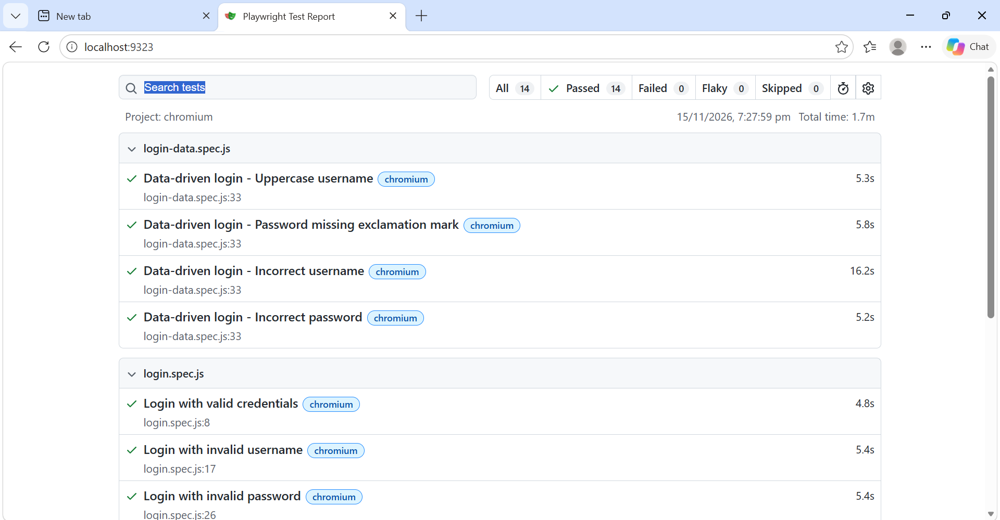

# Login Automation Testing Framework

**UI Automation with Playwright & JavaScript | API Testing with Postman & Newman**

A hands-on automation testing portfolio project demonstrating functional UI testing, data-driven testing, reusable Page Object Model design, API validation, and automated test execution.

## Project Overview

This project focuses on automating login functionality using Playwright with JavaScript and practicing API testing using Postman and Newman.

**UI Application Under Test:** https://the-internet.herokuapp.com/login

### Test Execution Summary

| Test Metric | Result |
|---|---|
| Playwright UI Tests | 14 Passed |
| UI Test Failures | 0 |
| Postman API Requests | 5 Executed |
| API Assertions | 11 Passed |
| Failed API Assertions | 0 |

*Results from the latest recorded local test execution.*

## Technologies and Tools

| Technology | Purpose |
|---|---|
| JavaScript | Automation scripting |
| Playwright | UI test automation |
| Node.js | JavaScript runtime |
| Visual Studio Code | Development environment |
| Postman | API testing |
| Newman | Command-line API test execution |
| Git | Version control |
| GitHub | Source code and portfolio hosting |

## UI Automation — Playwright

### Test Coverage

The UI automation suite contains 14 tests covering:

- Login with valid credentials
- Login with invalid username
- Login with invalid password
- Login with empty credentials
- Logout functionality
- Secure page access validation
- Access restriction after logout
- Data-driven login scenarios
- Username case sensitivity
- Password validation

### Framework Design

**Page Object Model (POM)**

Reusable locators and page actions are maintained separately from test cases to improve readability and maintainability.

**Data-Driven Testing**

JavaScript arrays are used to execute multiple login scenarios using different test inputs.

**Assertions and Reporting**

Playwright assertions validate application behavior. HTML reports, screenshots, and traces support test result analysis and debugging.

## API Testing — Postman & Newman

The API testing collection contains five authentication-related test scenarios.

| Test Scenario | Expected HTTP Status |
|---|---|
| Valid login | 200 |
| Invalid password | 401 |
| Missing password | 400 |
| Invalid username | 401 |
| Missing username | 400 |

### API Testing Concepts

- HTTP status code validation
- Response body validation
- Error message verification
- Positive and negative testing
- Postman test assertions
- Collection execution using Newman

The Postman collection is maintained separately from the Playwright UI test suite.

## Project Structure

- `pages/LoginPage.js` — Reusable Page Object Model
- `tests/login.spec.js` — Login automation test cases
- `tests/login-data.spec.js` — Data-driven login tests
- `postman/Login_Automation_API_Testing.postman_collection.json` — API test collection
- `screenshots/` — Playwright execution evidence
- `playwright.config.js` — Playwright configuration
- `package.json` — Dependencies and scripts
- `.gitignore` — Excluded generated and local files
- `README.md` — Project documentation

## Installation and Setup

1. Install Node.js and Visual Studio Code.
2. Clone this repository from GitHub.
3. Open the project folder in VS Code.
4. Open the integrated terminal.
5. Install dependencies using `npm ci` (if a lockfile exists) or `npm install`.
6. Install the Playwright browser dependencies using `npx playwright install`.

**Browser configuration:** The successful local UI execution used Microsoft Edge. When `channel: 'msedge'` is configured in `playwright.config.js`, Microsoft Edge must be installed on the machine.

## Execute UI Tests

Run all Playwright tests:

`npx playwright test`

Run tests in headed mode, one worker at a time:

`npx playwright test --headed --workers=1`

Open the Playwright HTML report:

`npx playwright show-report`

## Execute API Tests

Run the exported Postman collection using Newman:

`npx newman run postman/Login_Automation_API_Testing.postman_collection.json`

## Playwright Test Execution Evidence

**Total Tests: 14 | Passed: 14 | Failed: 0**

### Report Screenshot — Part 1

### Report Screenshot — Part 2

## Key Learning Outcomes

Through this project, I gained hands-on practice in:

- Designing and executing automated test cases
- Working with JavaScript and Playwright
- Implementing Page Object Model
- Building reusable test methods
- Performing data-driven testing
- Validating positive and negative scenarios
- Testing APIs using Postman
- Running API collections through Newman
- Debugging failures and reviewing test reports
- Maintaining project code with Git and GitHub

## Project Purpose

This project was developed as part of my practical learning journey in software automation testing.

It demonstrates foundational knowledge of UI automation, API testing, test framework organization, reusable code, and test execution reporting.

**Note:** The UI application is a publicly available demonstration website used for educational testing purposes.